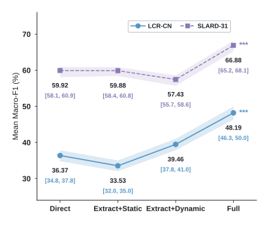
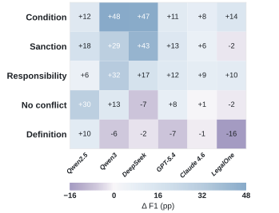

<div align="center">

# legalsem

**Knowledge-Guided Dynamic Legal Text Classification<br/>through Semantic Element Modeling**

[](LICENSE)


Reference implementation of an **inference-time knowledge-control layer** for legal text
classification. Structured legal knowledge is used as an explicit, inspectable decision
surface — not as passive context.

</div>


<p align="center"><sub><b>Figure 1.</b> Overview. <b>(a)</b> Six legal semantic elements are
extracted from the subordinate provision, using the superior provision as context. <b>(b)</b>
The structured evidence passes through a fixed, a priori label mapping into a candidate set;
the target backbone then classifies within that set only. <b>(c)</b> FGPR runs at development
time only: staged errors are routed and aggregated, a fixed optimizer LLM proposes prompt
bundles, the validation set selects one by Macro-F1, and the winning bundle is frozen before
test.</sub></p>

## Contents

[Method](#method) · [Results](#results) · [Quick start](#quick-start) ·
[Repository layout](#repository-layout) · [Experiment matrix](#experiment-matrix) ·
[Datasets](#datasets) · [Prompt versions](#prompt-versions) ·
[Configuration](#configuration) · [Analysis](#analysis) · [Citation](#citation)

---

## Method

Three stages, each a separate call in the pipeline:

```text
clause + superior laws
        │
        ├─(1) semantics──► extract legal elements
        │                   Subject / Action_Behavior / Condition
        │                   Responsibility / Sanction / Definition
        │
        ├─(2) control ───► element-to-label mapping  (fixed, a priori)
        │                   non-empty element → admissible class
        │                   empty extraction   → full label space (fallback)
        │
        └─(3) decide ────► model picks one class from the reduced set
```

| Element | Opens class |
| --- | --- |
| `Subject`, `Action_Behavior`, `Responsibility` | 1 — authority / responsibility mismatch |
| `Definition` | 2 — concept / definition scope |
| `Sanction` | 3 — sanction magnitude / range |
| `Condition` | 4 — applicability condition |

Class `0` (no conflict) is always admissible. The mapping is deliberate and
static: it is the audit surface the paper argues for, and it is never fitted on
training labels.

The release name `legalsem` stands for legal **sem**antic element modeling and is
shared with the library package `lsem/`.

## Results

<p align="center">
  
  
</p>

<p align="center"><sub><b>Left:</b> stage-wise mean Macro-F1 for Direct → Extract+Static →
Extract+Dynamic → Full, with 95% paired-bootstrap intervals.
<b>Right:</b> per-class effect size across all six backbones.</sub></p>

Each stage contributes: element extraction alone helps modestly, restricting the candidate
set is the largest single gain, and the frozen FGPR prompt bundle adds a further step. The
direction is consistent across all six backbones, which is the point of the paper's design —
the control layer sits outside the model, so it does not depend on which model is plugged in.

These figures are regenerated from stored predictions by the scripts in `analysis/`.

## Quick start

```bash
pip install -r requirements.txt

# credentials live in the environment, never in the source tree
export SILICONFLOW_API_KEY="..."
export LOCAL_VLLM_API_KEY="dummy"      # any non-empty string for local servers

# serve a local checkpoint (OpenAI-compatible)
vllm serve Qwen/Qwen3-8B --port 8000 --dtype float16
```

Stage 1 — element extraction:

```bash
python run.py extract --dataset lcr-cn --backbone qwen3-8b --split test
```

Stage 2 — dynamic classification over the extracted elements:

```bash
python run.py classify --dataset lcr-cn --backbone qwen3-8b \
    --elements conflict_superior_laws/output/full/elements/qwen3-8b_test_extract.jsonl --mode dynamic
```

Ablations and baselines:

```bash
# no dynamic candidates (full label space, elements still extracted)
python run.py classify --dataset lcr-cn --backbone qwen3-8b \
    --elements conflict_superior_laws/output/full/elements/qwen3-8b_test_extract.jsonl --mode static

# direct five-way classification, no element extraction
python run.py baseline --dataset lcr-cn --backbone legalone-8b --split test

# SLARD-31 topic classification follows the same two stages
python run.py extract  --dataset slard-31 --backbone qwen3-8b --split test
python run.py classify --dataset slard-31 --backbone qwen3-8b \
    --elements SLARD_classification/output/full/elements/qwen3-8b_test_extract.jsonl --mode dynamic
```

Add `--dry-run` to resolve inputs and print the plan without calling a model.
Add `--limit 20` for a smoke test. Runs are resumable: an interrupted job
continues from the last successful case.

## Repository layout

```text
run.py                     unified entry point for all stages
lsem/                      shared library
  backends.py              remote OpenAI-compatible API / local vLLM
  labels.py                conflict label space + candidate reduction
  topics.py                SLARD-31 topic task (evidence extraction + reduction)
  prompts.py               prompt-bundle loading and placeholder filling
  parsing.py               tolerant JSON / label extraction
  runner.py                resumable batch loop
  tasks.py                 extraction, classification, baseline stages
configs/backbones.yaml     one entry per backbone
prompts/                   prompt bundles (see prompts/README.md)
data/                      dataset placement + 20-case format samples
docs/figures/              figures used in this README
analysis/                  paired bootstrap CI and figure scripts
conflict_superior_laws/    LCR-CN: dataset notes, FGPR pipeline
SLARD_classification/      SLARD-31: dataset notes, FGPR pipeline
Model_download.py          checkpoint downloader
```

The six backbones used in the paper (Qwen2.5-7B, Qwen3-8B,
DeepSeek-R1-0528-Qwen3-8B, Claude Sonnet, GPT-5.4, LegalOne-8B) differ only in
`configs/backbones.yaml`; the experiment logic is shared, so a comparison across
backbones isolates the model rather than the harness.

## Experiment matrix

| Setting | Element extraction | Dynamic candidates | FGPR |
| --- | :---: | :---: | :---: |
| Direct (baseline) | no | no | no |
| No Dynamic | yes | no | no |
| No Verification | yes | yes | no |
| Full | yes | yes | yes |

`--mode static` maps to *No Dynamic*; the *Direct* row is the `baseline` task.
FGPR itself lives in the two `3.*` directories and is run separately — see
`conflict_superior_laws/3.verification/README.md`.

## Datasets

The datasets are **not** redistributed here. `data/lcr-cn/sample.jsonl` and
`data/slard-31/sample.json` contain 20 cases each, purely to document the field
layout. Place the full splits as:

```text
data/lcr-cn/{train,val,test}.jsonl
data/slard-31/{train,val,test}.json
```

Split sizes and field semantics are documented in the per-dataset READMEs
(`conflict_superior_laws/dataset/README.md`, `SLARD_classification/dataset/README.md`).
SLARD-31 derives from the publicly released SLARD split; LCR-CN is released
separately under the terms stated there. `conflict_type` and any gold field must
never enter the inference prompt — the runner only reads them to score outputs.

## Prompt versions

`prompts/base_prompts.json` (LCR-CN) and `prompts/base_prompts_slard31.json`
(SLARD-31) are the **initial** bundles — the starting point of FGPR. The
optimised bundles are not part of this release.

Consequence, stated plainly: running the pipeline as shipped reproduces the
*method*, not the exact Macro-F1 figures in the paper, which were obtained with
the post-optimisation prompt. To reproduce those numbers, supply your own
optimised bundle with the same schema via `--prompt-bundle`. See
`prompts/README.md` for the placeholder contract.

## Configuration

Backbones are declared in `configs/backbones.yaml`:

```yaml
backbones:
  qwen3-8b:
    backend: api                 # api | vllm
    model: Qwen/Qwen3-8B
    base_url: http://127.0.0.1:8000/v1
    api_key_env: LOCAL_VLLM_API_KEY
    sampling: {temperature: 0.0, top_p: 0.1, max_tokens: 1024}
```

`backend: api` covers any OpenAI-compatible endpoint — hosted vendor APIs,
third-party relays, and `vllm serve`. `backend: vllm` runs in-process and holds
the GPU for the whole job.

## Analysis

`analysis/` re-computes the paper's paired bootstrap confidence intervals and
class-level effects from stored predictions. It expects prediction files under
`conflict_superior_laws/output/`; produce them with `run.py` first. See
`analysis/README.md`.

## Notes on provenance

The code in this repository was reorganised for release. Per-model scripts that
differed only in client construction were consolidated into `lsem/` plus
`configs/backbones.yaml`; the numerical procedure (prompts, candidate rule,
decoding parameters, resumability semantics) is unchanged. Directory names such
as `pred_classfication` and `verfication` retain their original spelling so that
existing prediction paths and analysis scripts keep resolving.

## Citation

```bibtex
@article{shao2026knowledge,
  title   = {Knowledge-Guided Dynamic Legal Text Classification through
             Semantic Element Modeling},
  author  = {Shao, Yi and others},
  journal = {Journal of Intelligent Information Systems},
  year    = {2026}
}
```

## License

Released under the [MIT License](LICENSE). The datasets are not covered by this
license and remain under their own terms.
