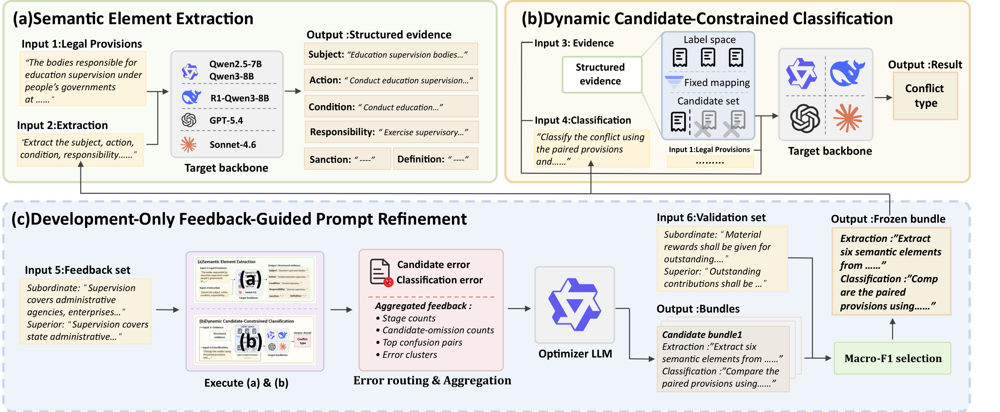

<div align="center">

# legalsem

**Knowledge-guided dynamic legal text classification through semantic element modeling**

[](LICENSE)


A model-agnostic inference-time control layer for Chinese legal text classification.
It extracts six legal semantic elements from a clause, maps them to a candidate label
subset, and lets any LLM classify inside that subset.

</div>



## Install

```bash
pip install -r requirements.txt
```

Python 3.9+. Any OpenAI-compatible endpoint works — local `vllm serve` or a hosted API.

## Quick start

```bash
# point the config at a served model
export LOCAL_VLLM_API_KEY=dummy
vllm serve Qwen/Qwen3-8B --port 8000 --dtype float16

# stage 1: extract semantic elements
python run.py extract  --dataset lcr-cn --backbone qwen3-8b --split test

# stage 2: classify inside the candidate set
python run.py classify --dataset lcr-cn --backbone qwen3-8b \
    --elements outputs/lcr-cn/full/elements/qwen3-8b_test_extract.jsonl --mode dynamic
```

Add `--dry-run` to print the resolved plan without calling a model, `--limit 20` for a
smoke test. Interrupted runs resume from the last successful case.

Ablations and baselines:

```bash
# full label space, elements still extracted
python run.py classify --dataset lcr-cn --backbone qwen3-8b \
    --elements outputs/lcr-cn/full/elements/qwen3-8b_test_extract.jsonl --mode static

# direct classification, no extraction
python run.py baseline --dataset lcr-cn --backbone legalone-8b --split test
```

## Tasks

| `--dataset` | Task | Labels | Entry point |
| --- | --- | :---: | --- |
| `lcr-cn` | Superior–subordinate law conflict | 5 | `run.py` |
| `slard-31` | Statute topic classification | 31 | `run.py` |

Both use the same two stages (extract → classify); only the label space and prompt
placeholders differ.

## Backbones

Edit `configs/backbones.yaml`. Six are wired up from the paper — Qwen2.5-7B, Qwen3-8B,
DeepSeek-R1-0528-Qwen3-8B, Claude Sonnet, GPT-5.4, LegalOne-8B:

```yaml
backbones:
  qwen3-8b:
    backend: api                 # api | vllm
    model: Qwen/Qwen3-8B
    base_url: http://127.0.0.1:8000/v1
    api_key_env: LOCAL_VLLM_API_KEY
    sampling: {temperature: 0.0, top_p: 0.1, max_tokens: 1024}
```

`backend: api` covers hosted APIs and `vllm serve`; `backend: vllm` runs in-process and
holds the GPU for the whole job. Credentials are read from the environment, never from
the config file.

## Project layout

```text
run.py                 CLI entry point for every stage
src/legalsem/          library: backends, labels, prompts, parsing, runner, tasks, topics
configs/               backbone declarations
prompts/               prompt bundles (initial versions)
data/                  dataset placement + 20-case format samples
pipeline/
  lcr_cn/              FGPR for the conflict task
  slard_31/            FGPR for the topic task
scripts/               figures and paired-bootstrap statistics
docs/figures/          images used in this README
```

## Data

Not redistributed. `data/lcr-cn/sample.jsonl` and `data/slard-31/sample.json` hold 20
cases each so you can check the field layout. Drop the full splits in as:

```text
data/lcr-cn/{train,val,test}.jsonl
data/slard-31/{train,val,test}.json
```

Gold fields (`conflict_type`, `category`) are read only for scoring — they never enter a
prompt. See `data/README.md` for field semantics and split discipline.

## Prompt bundles

`prompts/` ships the **initial** bundles, i.e. the starting point of the prompt
optimisation stage. The optimised bundles are not part of this release, so running the
pipeline as-is reproduces the method, not the exact numbers in the paper. Supply your
own bundle with the same schema via `--prompt-bundle` to reproduce those numbers.

## Prompt optimisation (FGPR)

Development-time only; the resulting bundle is frozen before test.

```bash
python pipeline/lcr_cn/run_fgpr.py optimize --config pipeline/lcr_cn/config.example.json
python pipeline/lcr_cn/run_fgpr.py test --config pipeline/lcr_cn/config.example.json \
    --frozen-prompt runs/qwen2.5-7b/frozen_prompt.json
```

Details in `pipeline/lcr_cn/README_fgpr.md`; the SLARD-31 counterpart is
`pipeline/slard_31/`.

## Citation

```bibtex
@article{shao2026knowledge,
  title   = {Knowledge-Guided Dynamic Legal Text Classification through
             Semantic Element Modeling},
  author  = {Shao, Yi and others},
  journal = {Journal of Intelligent Information Systems},
  year    = {2026}
}
```

## License

MIT — see [LICENSE](LICENSE). The datasets are not covered by this license.
